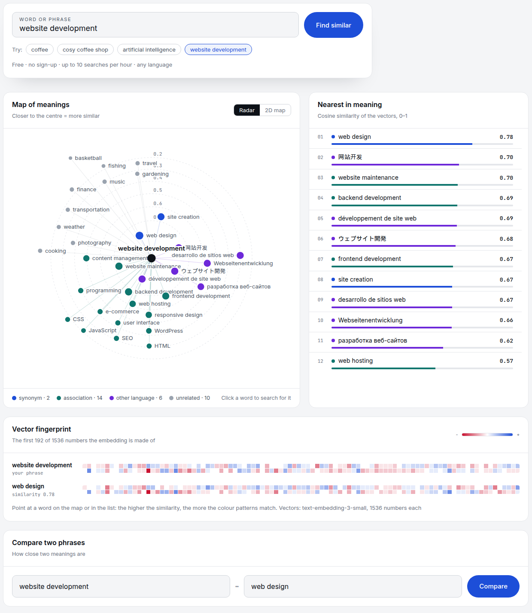

# Similar Words by Vector for Laravel

[](LICENSE)
[](composer.json)
[](composer.json)
[](composer.json)
[](https://yu.net.ua/en/tools/similar-words)

A Livewire tool for Laravel that shows which words and phrases a language model sees as close in meaning to yours. The visitor types a word or phrase in any language. An AI suggests about 40 candidates: synonyms, associations, translations and a few unrelated words. Their embeddings then decide the order: every candidate is ranked by the cosine similarity of its vector and placed on a map of meanings.



**🔗 Live example: [yu.net.ua/en/tools/similar-words](https://yu.net.ua/en/tools/similar-words)**

## What "similar by vector" means

A language model can turn any text into an embedding: a list of numbers, 1536 for `text-embedding-3-small`, that describes what the text means. Texts about the same thing get lists that point in nearly the same direction, even when they share no words or are in different languages: "coffee", "espresso" and "кава" end up close together, "football" far away.

How close two vectors point is measured by cosine similarity, from 0 (unrelated) to 1 (the same meaning). Semantic search, recommendations and chatbots that answer from your documents all work this way. This tool lets you see it: which words the model puts next to yours, and how far apart they are.

## What it shows

- **Map of meanings** in two views:
  - **Radar**: the phrase sits in the centre, and the closer a word is, the more similar it is. The rings follow the range of the scores.
  - **2D map**: all vectors projected onto their two main directions (PCA), so words with similar meanings form groups.
- **Ranking**: every word with its similarity from 0 to 1. Colours show the relation the AI labelled: synonym, association, other language or unrelated. The legend filters by relation.
- **Vector fingerprint**: the first 192 of the 1536 numbers of the phrase's embedding as coloured cells, next to the word you point at. The closer the meaning, the more the two patterns look alike.
- **Comparison**: the similarity of any two phrases, with a verdict in words.

Clicking a word on the map or in the list searches for it.

The AI only proposes and labels the words. Scores, order and positions are computed from the vectors, so the result is measured, not guessed.

## Requirements

- PHP ^8.4
- Laravel ^13.0
- Livewire ^4.0 (its bundled Alpine.js draws the map)
- An OpenAI API key

## Installation

```bash
composer require yu-laravel/similar-words
```

This also installs [`yu-laravel/web-tools-core`](https://github.com/yuriyakishin/laravel-web-tools-core). Both service providers are discovered automatically.

Add your OpenAI key to `.env`:

```
SIMILAR_WORDS_OPENAI_API_KEY=sk-...
```

Without a key, the tool stays unavailable.

## Usage

Put the component on a page whose layout includes `@livewireStyles` and `@livewireScripts`:

```blade
<livewire:similar-words />
```

Import the styles into your CSS build:

```css
@import "../../vendor/yu-laravel/web-tools-core/resources/css/web-tools-core.css";
@import "../../vendor/yu-laravel/similar-words/resources/css/similar-words.css";
```

Import the map script into your JS build. It defines `window.similarWords`, which the component's Alpine code uses:

```js
import '../../vendor/yu-laravel/similar-words/resources/js/similar-words.js';
```

To match your site's colours and fonts, override the `--wt-*` variables (see [Web Tools Core](https://github.com/yuriyakishin/laravel-web-tools-core#styles)). The colours of the four relations are `--sw-synonym`, `--sw-association`, `--sw-translation` and `--sw-unrelated`.

## Configuration

| Env variable | Default | Description |
|---|---|---|
| `SIMILAR_WORDS_ENABLED` | `true` | Turn the tool off without uninstalling it. |
| `SIMILAR_WORDS_OPENAI_API_KEY` | | OpenAI API key. |
| `SIMILAR_WORDS_OPENAI_BASE_URL` | `https://api.openai.com/v1` | Base URL of an OpenAI-compatible API. |
| `SIMILAR_WORDS_CHAT_MODEL` | `gpt-4o-mini` | Suggests and labels the candidate words. |
| `SIMILAR_WORDS_EMBEDDING_MODEL` | `text-embedding-3-small` | Turns the words into vectors. `text-embedding-3-large` gives better results for languages other than English, at a higher price. |
| `SIMILAR_WORDS_OPENAI_TIMEOUT` | `25` | Seconds to wait for OpenAI. |
| `SIMILAR_WORDS_PER_HOUR` | `10` | New searches per visitor IP per hour. |
| `SIMILAR_WORDS_COMPARE_PER_HOUR` | `40` | Comparisons per visitor IP per hour. |

A search costs one chat request and one embeddings request, a fraction of a cent. Results are cached for a week by phrase and language. A phrase someone has already searched comes from the cache and does not count against the limit. `config/similar-words.php` also sets the number of candidates (40), the length of the fingerprint (192) and the maximum length of a phrase (80 characters).

## What to expect from the scores

With `text-embedding-3-small`, even synonyms usually score 0.5–0.7, and unrelated words 0.1–0.25. What matters is the order: the higher a word is in the list, the closer it is in meaning. Short words in languages other than English score lower and are less consistent.

## Languages

The interface comes in English and Ukrainian. The language is taken from the visitor's browser, with your app locale as the fallback. Phrases can be in any language.

## Author

Yuriy Akishin:
- 🌐 Website: https://yu.net.ua
- 📧 Email: yuriy.akishin@gmail.com
- 💼 LinkedIn: https://www.linkedin.com/in/yuriyakishin/
- 💻 GitHub: https://github.com/yuriyakishin

## License

MIT. See [LICENSE](LICENSE).
